# AWS CloudTrail Security Investigation & Incident Response

Este repositório documenta um laboratório prático de **Resposta a Incidentes e Auditoria de Segurança em Nuvem**, simulando uma investigação forense real na **AWS** após um ataque a uma aplicação web.

## 🎯 Cenário do Incidente
A equipe da cafeteria *Café* relatou que o site web hospedado em uma instância EC2 sofreu uma desfiguração (ataque de *defacement*) e alterações não autorizadas nas regras de rede. Atuando como Analista de Segurança, o objetivo foi utilizar ferramentas nativas da AWS e do Linux para auditar os logs, identificar a origem do comprometimento, rastrear o invasor e blindar o ambiente contra futuras brechas.

---

## 🛠️ Ferramentas e Tecnologias Utilizadas
* **AWS CloudTrail:** Auditoria e registro de chamadas de API na conta AWS.
* **Amazon Athena:** Consultas SQL interativas diretamente sobre os logs armazenados no Amazon S3.
* **AWS CLI & Linux (SSH/Grep):** Análise de logs diretamente via terminal e execução de comandos de remediação no sistema operacional.
* **Amazon EC2 & Security Groups:** Gerenciamento de infraestrutura e regras de firewall de rede.
* **AWS IAM:** Gerenciamento de identidades e remoção de usuários maliciosos.

---

## 🚀 Passo a Passo da Investigação e Resolução

### Task 1: Configuração Inicial e Observação do Ambiente
* **O que foi feito:** Configuração segura do acesso SSH restrito ao IP pessoal no Security Group e validação do funcionamento normal do site da cafeteria.
* **Evidências:**
  * Regra restrita do Security Group: 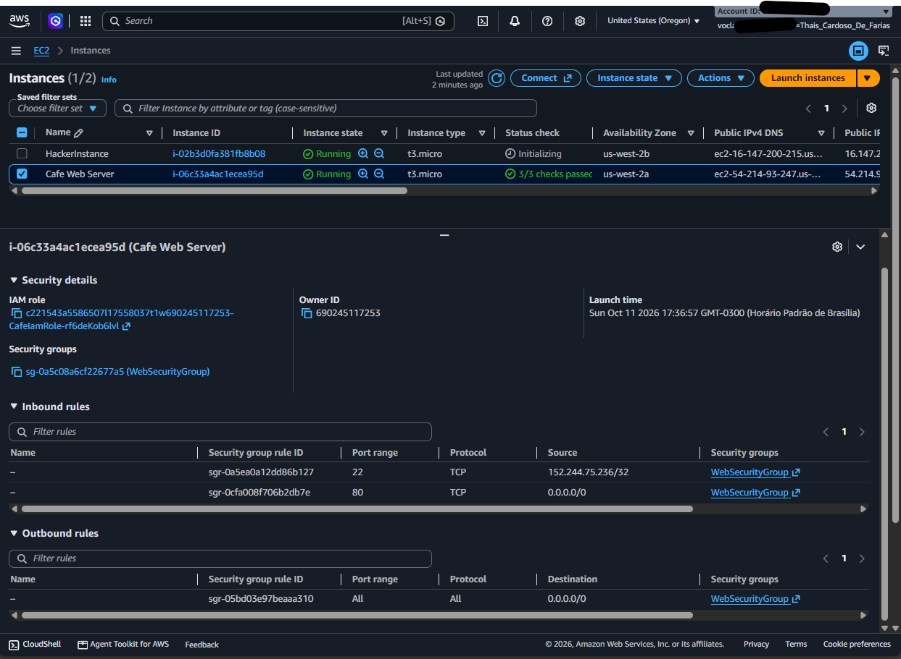
  * Site funcionando normalmente: 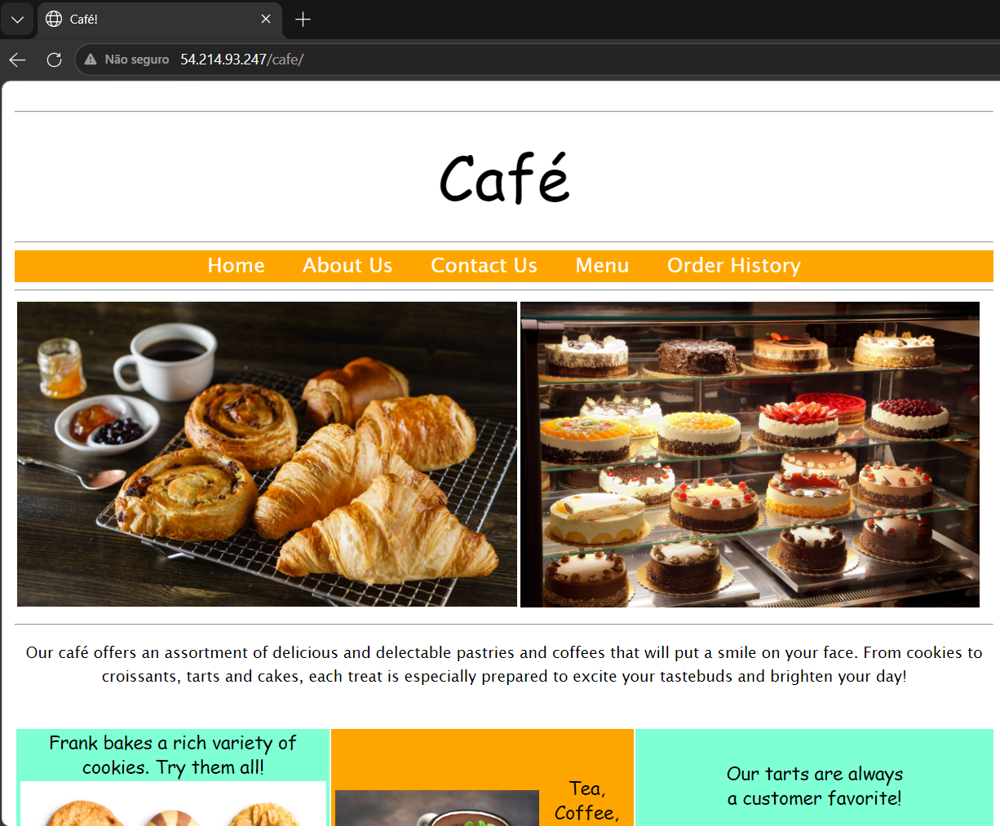

### Task 2: Habilitação do CloudTrail e Detecção do Ataque
* **O que foi feito:** Criação de uma trilha (*Trail*) no CloudTrail apontando para um bucket S3 dedicado (`monitoring5555`). Após alguns instantes, o site foi comprometido pelo invasor e uma regra maliciosa liberando a porta 22 para a internet inteira (`0.0.0.0/0`) foi injetada no Security Group.
* **Evidências:**
  * Trilha do CloudTrail criada (`monitor`): 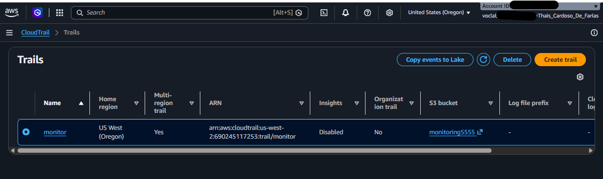
  * Site da cafeteria hackeado: 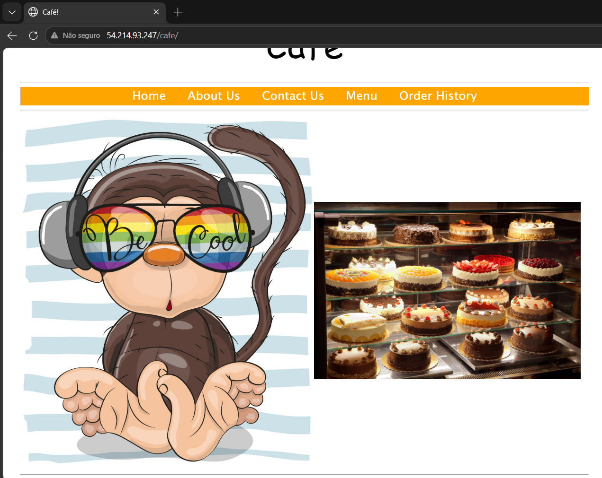
  * Regra maliciosa no Security Group: 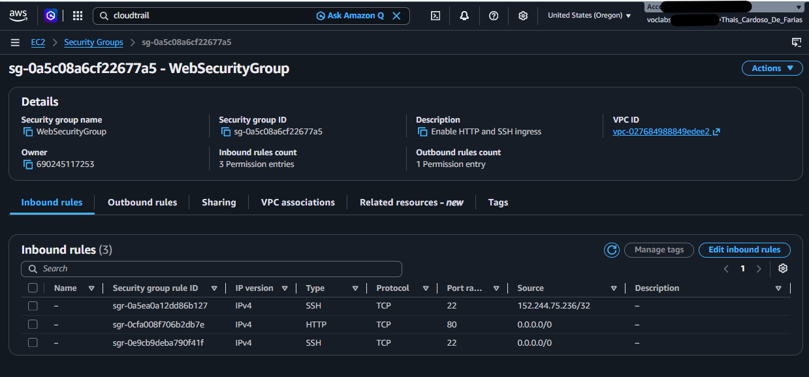

### Task 3: Análise de Logs com o Linux (Terminal & Grep)
* **O que foi feito:** Conexão SSH via PuTTY na instância EC2, download e descompactação dos arquivos de log do CloudTrail do S3 (`gunzip`), e uso de comandos `grep` e `python -m json.tool` para filtrar eventos por IP de origem e nome de eventos.
* **Evidências:**
  * Download dos logs do S3: 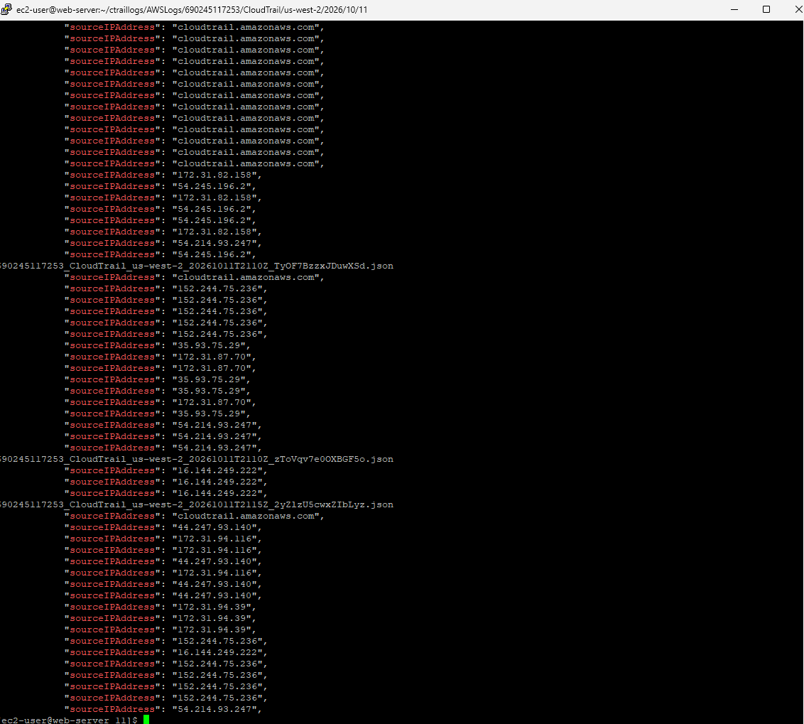
  * Análise via terminal: 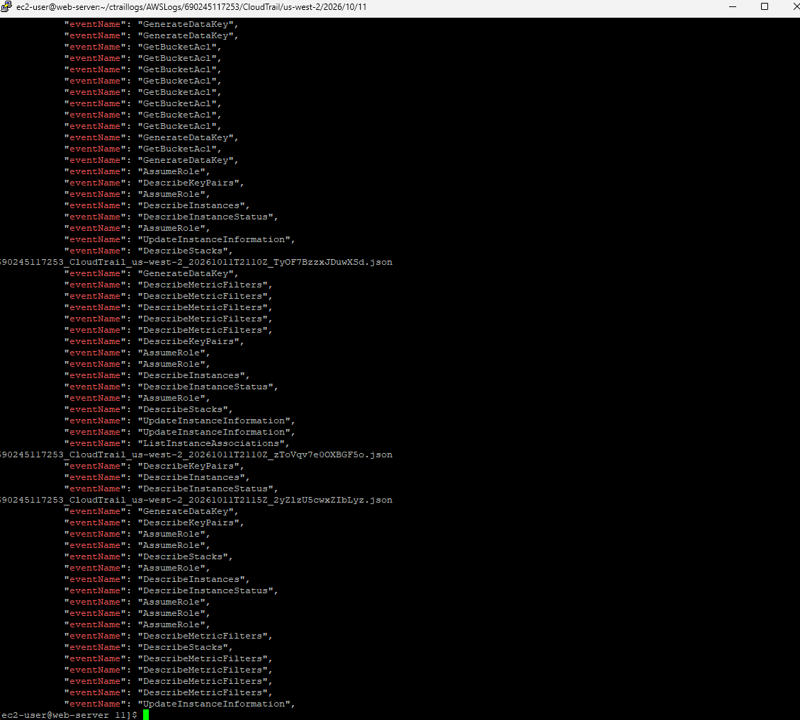

### Task 4: Investigação com CloudTrail e Athena
* **O que foi feito:** Criação da tabela de logs e utilização das ferramentas de consulta do CloudTrail e Athena para rastrear as alterações recentes na conta e identificar o invasor.
* **Resultado da Investigação:** Identificação do usuário malicioso **`chaos`** responsável pela alteração não autorizada no Security Group.
* **Evidências:**
  * Criação da tabela no Athena: 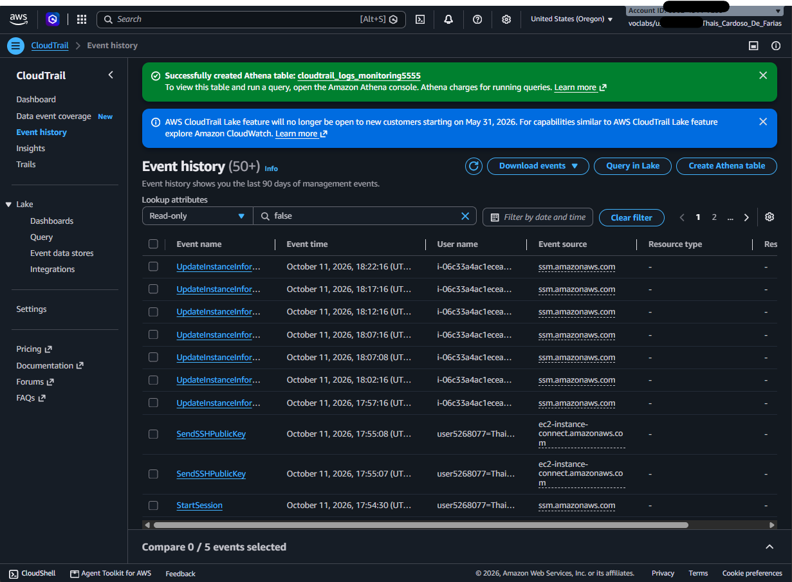
  * Histórico de eventos identificando o invasor: 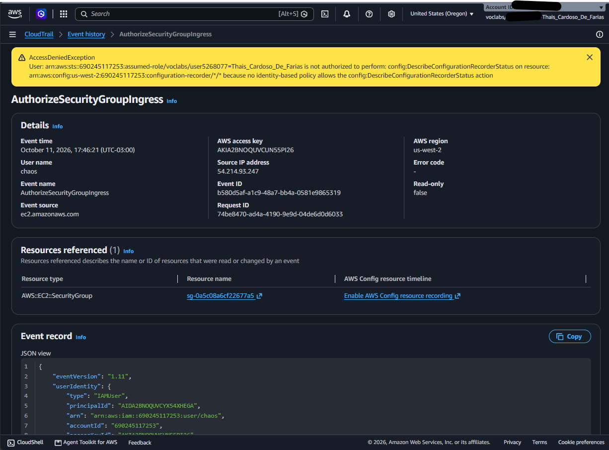

### Task 5: Mitigação, Remediação e Endurecimento (*Hardening*)
* **O que foi feito:**
  1. **Expulsão do Invasor:** Identificação de processos ativos do usuário intruso (`chaos-user`) no Linux, encerramento forçado e remoção definitiva do usuário.
  2. **Segurança SSH:** Desativação da autenticação por senha (`PasswordAuthentication no`) no arquivo `/etc/ssh/sshd_config` para exigir obrigatoriamente chaves criptográficas.
  3. **Correção de Rede:** Remoção da regra de firewall maliciosa que expunha a porta 22 no AWS Security Group.
  4. **Restauração da Aplicação:** Substituição da imagem modificada pelo invasor pela cópia de backup original (`Coffee-and-Pastries.backup`).
  5. **Limpeza no IAM:** Exclusão do usuário programativo **`chaos`** no console do IAM da AWS.
* **Evidências:**
  * Security Group blindado e corrigido: 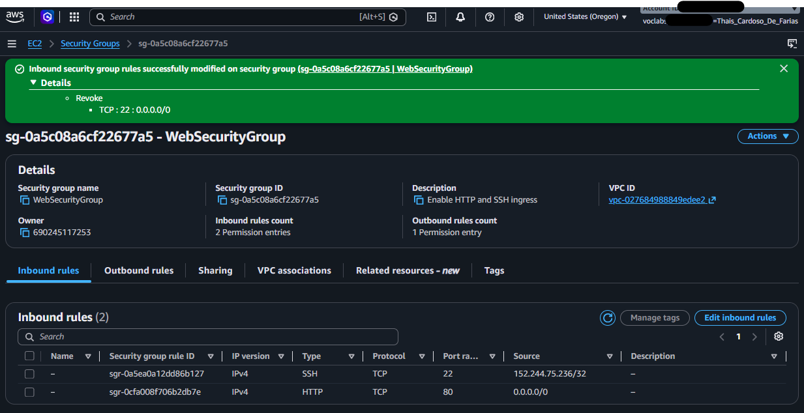
  * Site restaurado com sucesso: 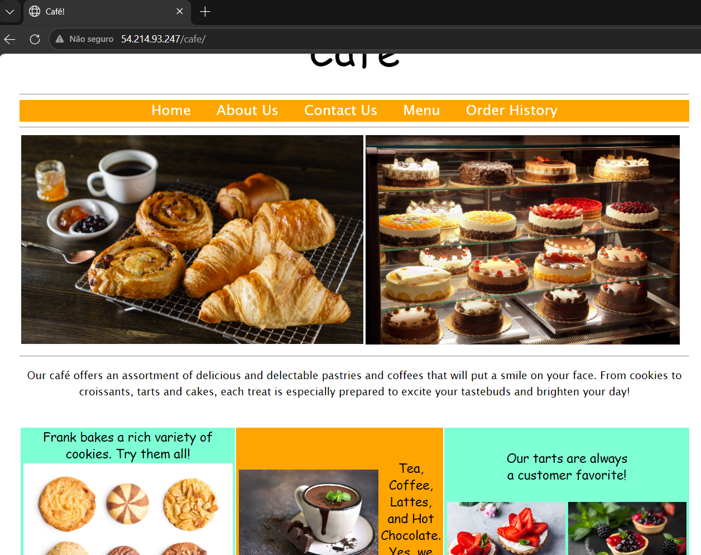
  * Exclusão do usuário malicioso no IAM: 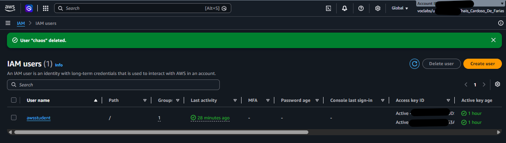

---

## 📈 Conclusão e Aprendizados
Este laboratório proporcionou uma experiência prática valiosa em **computação forense em nuvem**, demonstrando a importância crítica de:
* Manter o **AWS CloudTrail** sempre ativo para auditorias de conformidade e segurança.
* Utilizar consultas estruturadas para analisar grandes volumes de logs de auditoria.
* Aplicar princípios de **Least Privilege (Menor Privilégio)** em identidades IAM e regras de rede restritas (Security Groups).
